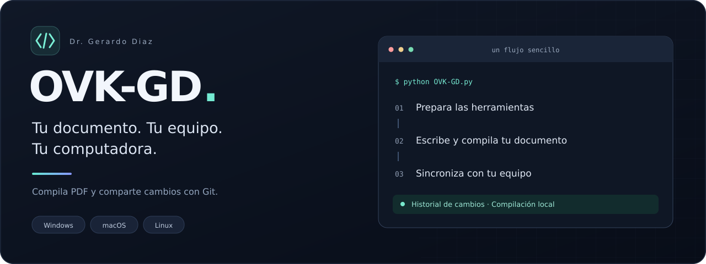

<p align="center">
  
</p>

<p align="center">
  <strong>Dr. Gerardo Diaz</strong><br>
  Compila LaTeX en tu computadora y trabaja en equipo con Git.<br>
  Windows · macOS · Linux · Python 3.8+ · Interfaz en español
</p>

<p align="center">
  <a href="#empezar">Empezar</a> ·
  <a href="MANUAL_OVK-GD.md">Manual completo</a> ·
  <a href="docs/PUBLICAR_EN_GITHUB.md">Publicar en GitHub</a> ·
  <a href="CONTRIBUTING.md">Contribuir</a>
</p>

---

## Escribe aquí. Comparte con tu equipo.

OVK-GD reúne la instalación de herramientas, la compilación de PDF y la sincronización de proyectos LaTeX en un menú de terminal. Está pensado para tesis, artículos, reportes y materiales de clase que se escriben entre varias personas.

La compilación se ejecuta localmente mediante `latexmk` y tu distribución de LaTeX. Puedes seguir escribiendo y compilando sin conexión una vez instalados los paquetes necesarios. Git conserva el historial; GitHub o GitLab permiten compartirlo.

> **Colaboración por sincronización.** Cada persona edita una copia local y después comparte sus cambios. La edición simultánea en tiempo real no está incluida. Repartir capítulos o secciones entre archivos facilita el trabajo.

## Qué puedes hacer

| Función | Para qué sirve |
|---|---|
| Instalar y actualizar | Preparar Git, LaTeX y, donde se automatiza, Visual Studio Code. |
| Abrir un proyecto local | Utilizar la carpeta de la PC y reutilizar su URL guardada. |
| Crear o descargar proyectos | Preparar un documento nuevo o clonar un repositorio por primera vez. |
| Sincronizar | Guardar cambios en Git, incorporar los del equipo y subir los tuyos. |
| Compilar PDF | Ejecutar `latexmk` con `pdflatex` y mostrar el resultado. |
| Abrir en VS Code | Editar con LaTeX Workshop y compilar al guardar. |
| Sincronizar periódicamente | Repetir la sincronización mientras la aplicación permanece abierta. |
| Diagnosticar | Verificar las herramientas y la extensión de VS Code. |
| Consultar y descargar versiones | Ver commits con su autor, generar su PDF y guardar una copia local independiente. |
| Elegir el principal | Guardar qué proyecto y archivo `.tex` utilizarás para las compilaciones habituales. |

El programa usa únicamente la biblioteca estándar de Python: **no necesitas ejecutar `pip install`**. LaTeX, Git y VS Code son aplicaciones externas.

## Empezar

### 1. Descarga y extrae

En la página de este repositorio, selecciona **Code → Download ZIP** y extrae todo su contenido. Conserva `OVK-GD.py` y los lanzadores en la misma carpeta.

Si ya usas Git, también puedes clonar el enlace que aparece en **Code**.

### 2. Abre el lanzador

| Sistema | Cómo abrir OVK-GD | Herramientas de compilación |
|---|---|---|
| Windows 10/11 | Doble clic en `OVK-GD_windows.bat`. | MiKTeX + Perl + latexmk. |
| macOS | En Terminal: `bash OVK-GD_mac_linux.command`. | BasicTeX + paquetes de TeX Live. |
| Ubuntu / Debian | En Terminal: `bash OVK-GD_mac_linux.command`. | TeX Live + latexmk. |
| Fedora | En Terminal: `bash OVK-GD_mac_linux.command`. | TeX Live + latexmk. |

Ejecuta los comandos desde la carpeta extraída. Se necesita **Python 3.8 o superior**. El lanzador de Windows ofrece instalar Python 3.12 si falta y encuentra `winget`. En macOS/Linux, instala Python previamente si no está disponible.

En macOS se requiere [Homebrew](https://brew.sh/) para la instalación automática. En Linux, VS Code se instala por separado. Consulta los detalles y las alternativas en el [manual](MANUAL_OVK-GD.md#2-instalar-en-tu-sistema).

### 3. Prepara tu entorno

Al abrir el menú por primera vez:

1. Elige **1 — Instalar herramientas**. Revisa los mensajes; algunas instalaciones requieren permisos de administrador.
2. Cierra y vuelve a abrir el lanzador.
3. Elige **8 — Diagnóstico** para comprobar qué herramientas están disponibles.
4. Usa **3 — Abrir un proyecto desde una carpeta de la PC** si ya tienes sus archivos. Para crear un documento o descargar un repositorio por primera vez, utiliza **11**.

La descarga de herramientas y paquetes requiere internet y puede ocupar varios GB. La duración depende del equipo y de los paquetes seleccionados.

## Abrir y continuar tu proyecto

La opción **3** abre una carpeta que ya está en tu PC. Pega su ruta o escribe **E** para seleccionarla desde una ventana. También puedes indicar el archivo principal `.tex` o `OVK-GD.proyecto.json`.

La aplicación conserva la ubicación elegida y el archivo principal, de modo que al cerrar y abrir el lanzador puedes continuar con **5 — Compilar PDF** o **6 — Abrir en VS Code**. El menú muestra la carpeta y la URL del proyecto.

Al crear o registrar un proyecto se guarda **`OVK-GD.proyecto.json` dentro de su carpeta**, con el nombre, la URL de GitHub/GitLab y el `.tex` principal. Al abrirlo, esos datos se reutilizan: no tienes que volver a escribir la URL ni descargar otra copia. Si la carpeta ya era un clon de Git, se obtiene el enlace de su configuración existente.

Abrir es una operación local. Para incorporar cambios del equipo utiliza después **4 — Sincronizar**. Si mueves la carpeta, vuelve a seleccionarla con **3**; la ruta local se actualiza y los datos del proyecto se conservan.

Usa **11 — Crear un proyecto nuevo o descargar de GitHub** para preparar un proyecto nuevo o hacer su primera descarga. Dentro de ese asistente también puedes conectar una carpeta local a GitHub/GitLab una sola vez, conservando sus archivos.

## Tu rutina de trabajo

1. **Antes de escribir:** opción **4**, sincronizar.
2. **Para editar:** opción **6**, abrir el proyecto en VS Code.
3. **Para generar el PDF:** guarda en VS Code o usa la opción **5**.
4. **Al terminar:** opción **4**, sincronizar y describir los cambios.

Al sincronizar, OVK-GD guarda los cambios locales, incorpora los del remoto mediante una mezcla de Git y después intenta subir el resultado. Si falta conexión, puedes conservar commits locales para enviarlos después. Si aparece un conflicto, consulta el [procedimiento del manual](MANUAL_OVK-GD.md#6-resolver-conflictos).

## Versiones del documento: consultar, descargar y compilar

La opción **9 — Historial: PDF, descargar versiones y elegir principal** abre el historial del proyecto seleccionado.

- Muestra inicialmente hasta **10 commits**, con identificador, descripción, autor y fecha. Incluye al menos cinco versiones anteriores si hay seis o más commits disponibles.
- Escribe el **número del commit** para abrir sus acciones: **1**, compilar su PDF; **2**, guardar la versión en una carpeta local; **3**, descargarla y utilizarla como proyecto principal.
- Usa **M** para mostrar diez commits más, **R** para consultar la rama remota tras descargar su historial y **L** para volver al historial local.
- El PDF se conserva con el identificador del commit en el nombre, junto con sus fuentes y un archivo `version.json`.

Tus archivos actuales, los cambios sin commit, la rama y el índice de Git se conservan. La actualización del historial usa `git fetch`; la compilación histórica exporta el commit sin cambiar la revisión activa.

Las consultas en PDF se guardan normalmente en `~/.ovk-gd/versiones/`. Para **descargar una versión**, eliges una carpeta nueva; se propone una dentro de `Proyectos_OVK-GD`. La copia conserva los archivos e historial Git del commit seleccionado y se prepara en una rama propia para que puedas seguir editando.

Si eliges **3 — Descargar y usar como proyecto principal**, la opción **5 — Compilar PDF** utilizará el `.tex` seleccionado en esa copia. La elección se conserva al cerrar y abrir la aplicación. Si hay varios documentos principales, puedes elegir cuál utilizar.

Usa **10 — Elegir proyecto y archivo principal de compilación** para regresar al proyecto original o seleccionar otro archivo `.tex`. El menú muestra el proyecto, archivo y carpeta que están activos. Las acciones de sincronización, edición e historial también usan el proyecto principal seleccionado.

La descarga no publica cambios. Si después sincronizas la copia, se utiliza una rama `ovk-version-...` propia. Consulta el [manual del historial](MANUAL_OVK-GD.md#11-versiones-anteriores-y-pdf) para los detalles.

## Un documento, varios archivos

El ejemplo incluido separa la introducción y la metodología para que dos personas puedan trabajar en archivos diferentes:

| Archivo | Contenido |
|---|---|
| `ejemplos/documento/main.tex` | Estructura general y llamadas a las secciones. |
| `ejemplos/documento/secciones/introduccion.tex` | Contexto y objetivo del documento. |
| `ejemplos/documento/secciones/metodologia.tex` | Desarrollo y ecuación de ejemplo. |

Copia **el contenido de `ejemplos/documento/` a una carpeta nueva**, fuera de este repositorio, y regístrala con la opción 3. Así mantienes separados el código de OVK-GD y los documentos de tu equipo.

## Uso desde terminal

```bash
python OVK-GD.py --help
python OVK-GD.py instalar
python OVK-GD.py diagnostico
python OVK-GD.py abrir "CARPETA_DEL_PROYECTO"
python OVK-GD.py proyecto
python OVK-GD.py sincronizar -m "Actualiza la introducción"
python OVK-GD.py compilar
python OVK-GD.py historial
python OVK-GD.py historial --cantidad 20 --actualizar
python OVK-GD.py compilar-version IDENTIFICADOR_DEL_COMMIT
python OVK-GD.py descargar-version IDENTIFICADOR_DEL_COMMIT --principal
python OVK-GD.py principal
python OVK-GD.py auto
python OVK-GD.py --simular instalar
```

En macOS/Linux, usa `python3` si `python` no corresponde a Python 3. En Windows también puedes usar `py -3`.

`--simular` permite inspeccionar la instalación o actualización sin ejecutarla. Se escribe **antes** del subcomando. Los comandos de proyecto, compilación y sincronización usan los proyectos registrados en la aplicación.

Cuando hay un proyecto principal seleccionado, los comandos lo utilizan directamente. El comando `principal` permite cambiar la selección.

## Qué incluye este repositorio

| Ruta | Descripción |
|---|---|
| [`OVK-GD.py`](OVK-GD.py) | Programa y menú de terminal. |
| [`MANUAL_OVK-GD.md`](MANUAL_OVK-GD.md) | Instalación, uso, autenticación y solución de problemas. |
| [`docs/PUBLICAR_EN_GITHUB.md`](docs/PUBLICAR_EN_GITHUB.md) | Cómo cargar y presentar este proyecto en tu cuenta. |
| [`ejemplos/documento/`](ejemplos/documento/) | Documento breve dividido en secciones. |
| [`tests/`](tests/) | Pruebas de sincronización y compilación. |
| [`.github/`](.github/) | Comprobaciones automáticas y plantillas de colaboración. |

## Alcance y estado

- La interfaz es un menú de terminal en español.
- El comando de compilación utiliza `pdflatex`; otros motores se configuran por separado en el editor o mediante herramientas LaTeX.
- La compilación local depende de la memoria, el disco y los paquetes de tu equipo.
- Los instaladores automatizan comandos de los gestores de cada sistema. Su disponibilidad depende del entorno.
- El proyecto incluye un flujo de GitHub Actions para comprobar Python y Git en Windows, macOS y Linux. Los resultados aparecen después de publicar y ejecutar el flujo; esto no valida los instaladores completos.

La validación realizada para esta entrega se describe en [`docs/VALIDACION.md`](docs/VALIDACION.md).
